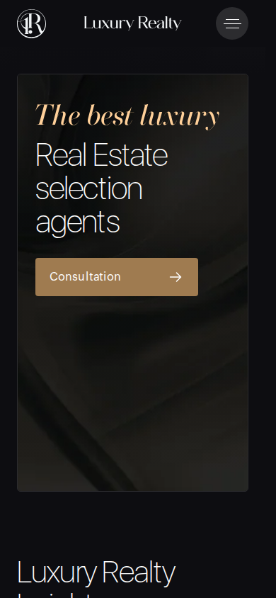
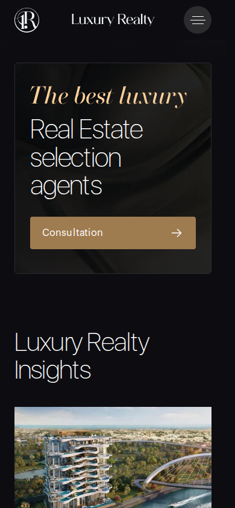
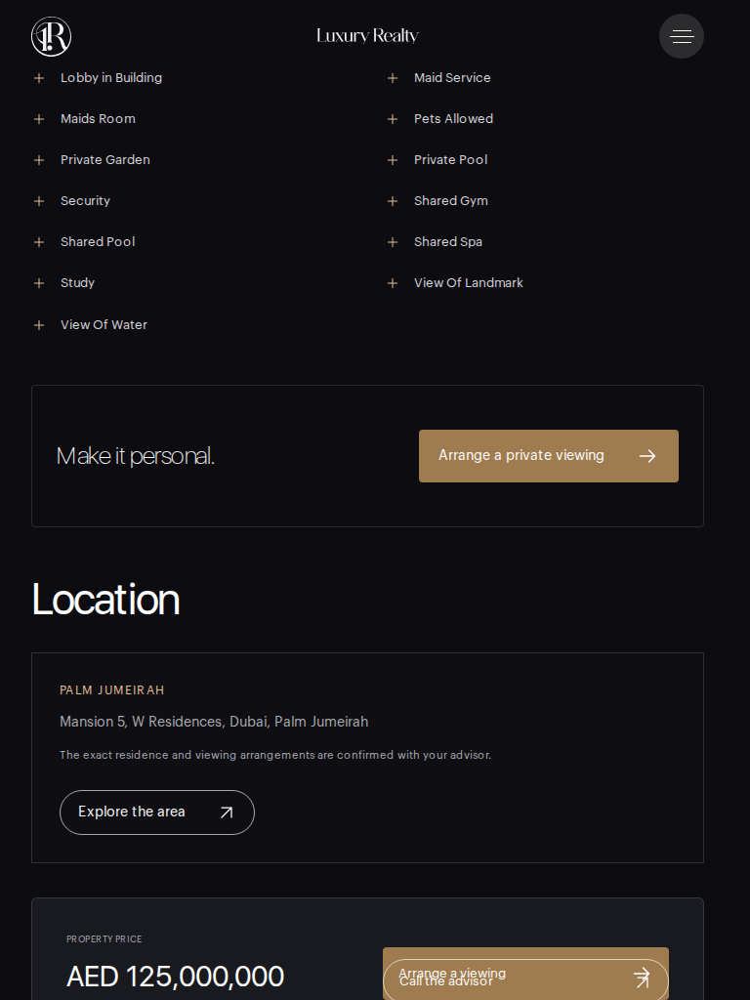
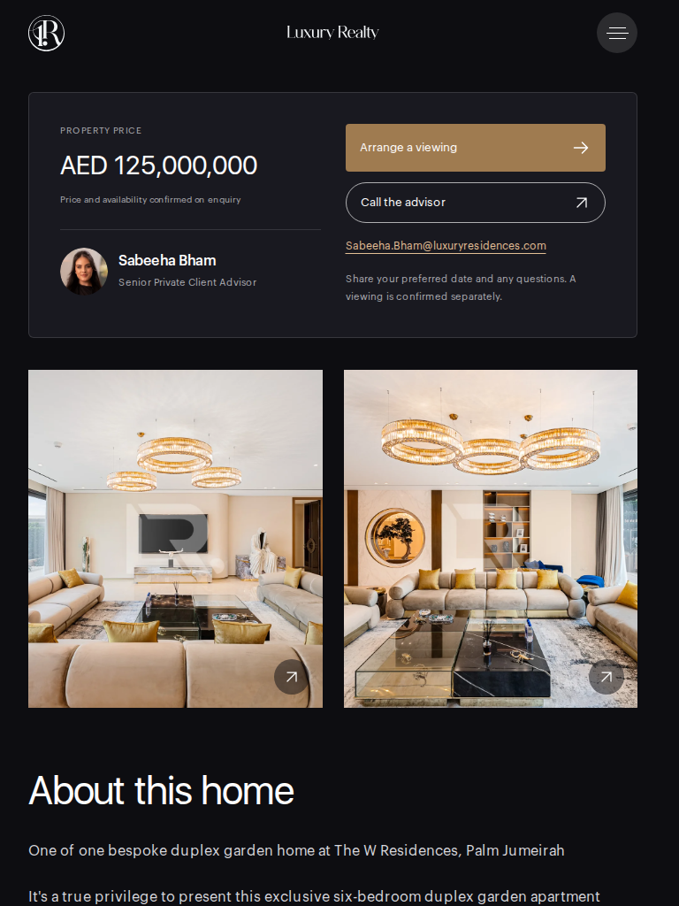
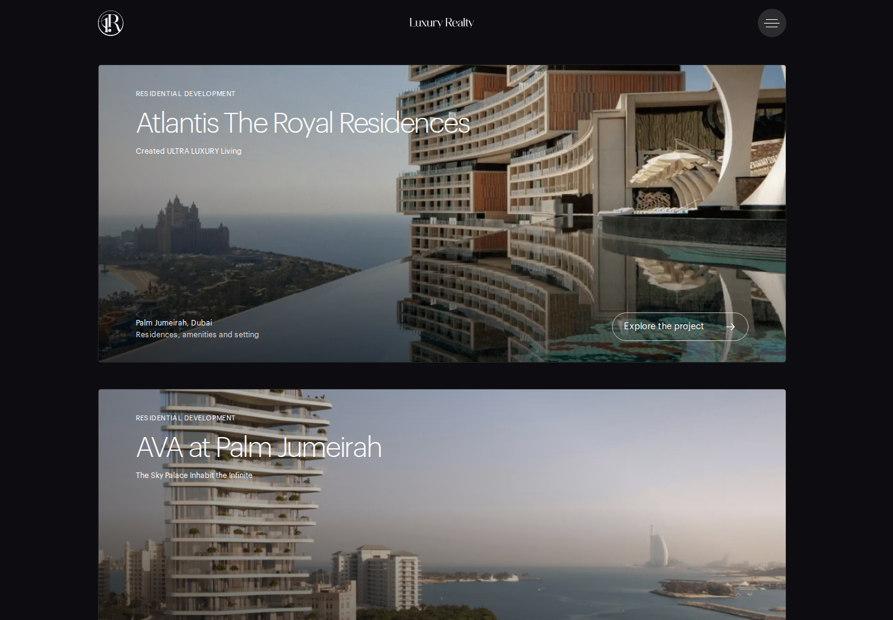
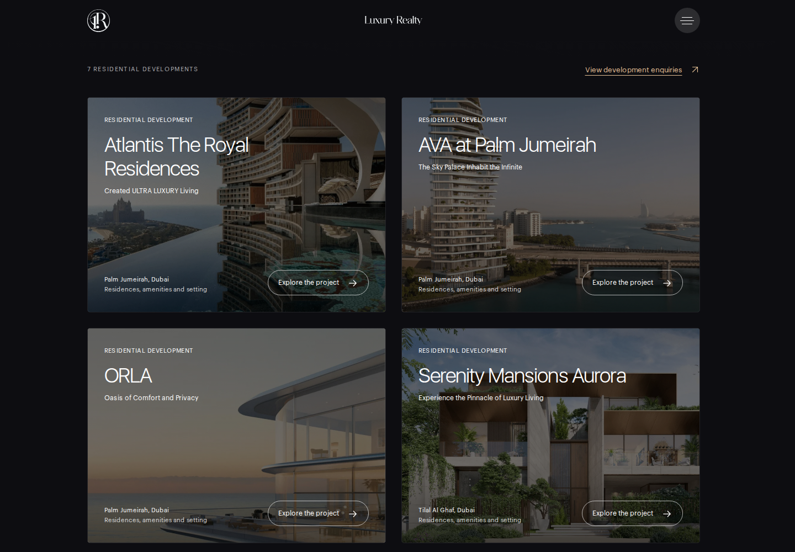

# Luxury Realty: глобальный визуальный аудит

Дата: 3 ноября 2026 года.

**Статус: локальная визуальная приемка завершена.** Финальный кандидат проверен; внешняя ссылка и source commit будут зафиксированы после публикации preview.

Аудит выполнен после отклонения предыдущего preview пользователем. Предыдущие технические проверки миграции не подтверждали качество всех макетов. Здесь отдельно зафиксированы реальные дефекты, изменения общих шаблонов, свежие изображения страниц и ограничения проверки.

## Что исправлено

| Раздел | Подтвержденная проблема | Изменение |
| --- | --- | --- |
| Объект, планшет | Кнопки Arrange a viewing и Call the advisor перекрывались. На 768 px пересечение составляло 293,5 × 42 px, ссылка звонка перехватывала клик. | Явный блок действий с отдельным потоком кнопок заменил размещение по типу HTML-тега. |
| Объект, мобильный и планшет | Цена и агент находились после фотографий, описания, характеристик и расположения. На проверенном экране 840 px блок начинался ниже 4400 px. | Порядок: заголовок, цена и контакт с агентом, затем подробности объекта. На desktop сохранена боковая колонка. |
| Каталог | Длинные названия с разделителями перегружали карточки, цены внутри одного ряда смещались относительно друг друга. | Основной заголовок отделен от уточнений; цена и характеристики закреплены в общей нижней области карточки. Полный исходный текст сохранен для поиска и метаданных. |
| Формы просмотра | В видимом заголовке формы показывался технический slug объекта. | Пользовательская подпись отделена от технического контекста заявки. |
| Главная, консультация | После удаления старого портрета сохранялась фиксированная высота: 590 px на мобильном. Возникала большая пустая нижняя область. | Высоту определяет реальное содержимое. Заголовок и действие образуют компактную композицию. |
| Главная, горизонтальные ленты | Первая карточка отличалась по отступу от общего контейнера. Лента статей сама прокручивалась на величину padding при scroll snap. | Уточнены расчет контейнера и scroll-padding. Проверенные края: 24 px на 390, 32 px на 768 и 157,5 px на 1440. |
| Проекты | Семь больших профилей повторялись дополнительными карточками заявок, страница теряла ритм. | Компактная сетка: две колонки на больших экранах, одна на мобильном. Ниже остаются три дополнительных проекта; полный список девяти заявок доступен в каталоге. |
| Проекты, изображения и подписи | Белый текст терялся на светлом небе. Мобильная подпись расположения сдвигалась вправо. | Единое плавное затемнение фотографии, выравнивание подписи по левому краю и отдельное расположение CTA. |
| Карты проектов | Три карты распознавались как фотографии. Карта Waterfront теряла около 61% высоты на мобильном и 71% на широких экранах. | Отдельные блоки расположения с contain, ссылкой на полное изображение и подписью. Карты исключены из фотогалереи, их наличие на странице проверяется отдельно. |
| Aurora | Единственный вводный текст занимал половину двухколоночной сетки; вторая половина была пустой. | Единственный блок использует всю ширину, с заголовком и текстом в двух колонках выше 700 px и последовательным порядком на мобильном. |
| Команда | Маленькие исходные фотографии растягивались в большие портретные карточки; формат профилей был неодинаковым. | Компактные портреты одного формата, согласованные имена и роли, две колонки на планшете. Биографии и контактные ссылки сохранены. |
| Формы связи и оценки | Узкие колонки на планшете; сообщение валидации сдвигало сетку и сжималось рядом с кнопкой. | Более ранний переход в одну колонку; статус формы занимает отдельную строку. Проверены пустая локальная валидация и доступность submit после прокрутки. |
| Галерея | На узких экранах счетчик 1 / 29 переносился на две строки. | Счетчик сохраняет одну строку, заголовок переносится в оставшейся ширине, кнопка закрытия остается доступной. |
| Статьи | Четыре статьи образовывали ряд из трех и одинокую карточку под ним. | Сетка 2 × 2 на больших экранах, одна колонка на мобильном; нижние ссылки выровнены. |
| Качество изображений | Для высоких карточек и широких блоков выбирались слишком маленькие варианты файлов. | Размеры источников учитывают реальный cover. Например, портретные карточки 350 × 513 теперь используют 960 × 641 вместо 480 × 321. |
| Навигация и текст | Email в планшетном меню нарушал край; в описании ORLA встречались склеенные слова. | Контролируемая возможность переноса после @; адрес сохранен. Известные ошибки пробелов исправлены в отображаемом тексте, архив источника сохранен. |

## Сохраненная логика сайта

Фирменная типографика, палитра, логотип, композиция hero и авторское смещение карточек на главной сохранены. Исправления относятся к работе существующего дизайна с перенесенным содержимым.

В каталоге сохранены все 110 записей. Публичные профили проектов, архивные объекты, контактные данные, исходные фотографии и видео остаются связанными со своими записями. Полные названия не сокращались до потери сведений. Для двух исходных названий в верхнем регистре задано явное аккуратное отображение; ORLA, VELA, 3BR и 2BR сохранены.

Разделение карт и фотографий усилено проверкой сборки: карта должна присутствовать как реальный локальный img на соответствующей странице проекта. Простое исключение карты из ожидаемого числа фотографий не считается достаточной проверкой.

## Объем визуальной проверки

Полная матрица охватывает **85 сочетаний страницы и ширины**, включая главную, каталог продажи и аренды, архив, заявки на проекты, обычный и архивный объект, длинное описание объекта, список проектов, все семь профилей, команду, услуги, продажу, контакты, статьи, отдельную статью, privacy и 404.

Основные ширины: 390, 768, 1024 и 1440 px. Дополнительно проверены границы 320 и 1920 px для ключевых шаблонов и 720 px для формы оценки. Открытое меню, галерея, форма просмотра, локальная валидация и раскрытая биография проверяются отдельными состояниями.

Фактические этапы:

- Сокращенное сравнение до изменений: 18 состояний, 68 PNG. 17 состояний завершены; оставшееся остановилось на реальном перехвате кнопки просмотра перекрывающей ссылкой звонка.
- Полный первый просмотр исправленной версии: 85 из 85 состояний, 232 PNG. Нулевые геометрические ошибки не означали окончательную визуальную приемку: по изображениям были найдены дополнительные проблемы.
- Повторная проверка измененных шаблонов: 50 из 50 состояний, 154 PNG. Включены галерея и форма на 320 px, реальная прокрутка к кнопке отправки. Все машинные проверки этого этапа завершились; свежий Chromium functional report имеет ok: true.
- Финальная проверка последних локальных исправлений: 32 из 32 состояний, 98 PNG; нулевые ошибки и предупреждения геометрии, JavaScript, консоли и загрузки ассетов. Свежие снимки просмотрены отдельно, подтвержденные замечания закрыты. Публичные изображения добавляются после публикации.

Снимки создаются после загрузки шрифтов и видимых фотографий, с реальной прокруткой страницы для ленивой загрузки. Используется обычная системная настройка reduced motion. Содержимое страницы и CSS для снимков не подменяются.

Ручная приемка имеет отдельные receipts с точными именами просмотренных файлов и границами вывода. Просмотр верхнего экрана не считается просмотром всей страницы. Проверены общие шаблоны и реальные сложные записи; индивидуальный ручной просмотр каждой из 110 карточек не заявляется.

## Техническое подтверждение и ограничения

Проверяются типы, 24 unit tests, сборка и наличие 130 канонических страниц. Отдельная проверка сборки контролирует локальные изображения, галереи, карты, ссылки и полноту миграции. Функциональная проверка использует тестовые ответы; реальные заявки в ходе аудита не отправляются.

Физические размеры bitmap проверяются отдельно от CSS naturalWidth: браузер корректирует naturalWidth с учетом srcset, поэтому одна такая величина не доказывает размытие. Для импортированных изображений расчет cover использует фактическую ширину и высоту выбранного файла. Для четырех фотографий статей дополнительно проверяются бинарники из assets.

Имеющееся разрешение части источников ограничено: poster hero имеет максимум 1280 × 720, а часть обложек проектов имеет 1000 × 1000. На больших экранах это ограничивает резкость. Проверка размеров выполнена при DPR 1; отдельная визуальная приемка всех моделей телефонов и всех вариантов DPR не заявляется.

Ожидаемые HTTP 404 зафиксированы только в специально проверяемых состояниях отсутствующей страницы. В отчетах они отделены от ошибок JavaScript и загрузки реальных ассетов.

Первый общий управляющий job сохранил технически успешный последний проход, но завершился без публикации после исчерпания трех циклов: ручной просмотр требовал еще локальных исправлений. Его исходные отчеты и коды завершения сохранены. Финальный job проверяет конкретный diff от этого состояния; прежний failed receipt не переименовывается в успешный.

## Доказательства

Выборка снимков до и после, исходные JSON-отчеты, результаты независимых просмотров и хеши находятся в [manifest evidence](evidence/manifest.json). Большие исходные JSON сохранены в gzip с хешем несжатых данных. Новые отчеты не подменяют предыдущие результаты.

Публикация, точный source commit и результат проверки внешней ссылки будут зафиксированы ниже.

## Сравнение до и после

### Консультация на мобильном

| До | После |
| --- | --- |
|  |  |

### Блок цены и просмотра на планшете

На исходном снимке внизу видны перекрывающиеся кнопки. В исправленной версии блок находится перед подробностями объекта, действия разделены.

| До | После |
| --- | --- |
|  |  |

### Список проектов

| До | После |
| --- | --- |
|  |  |
